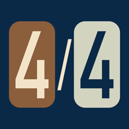
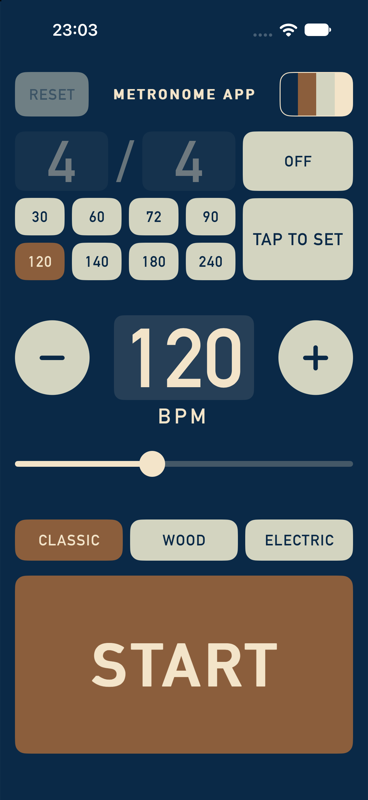
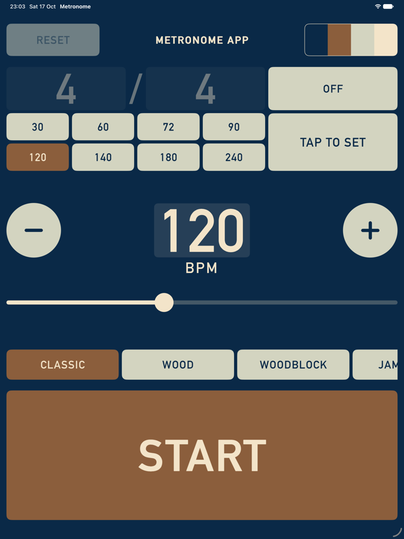
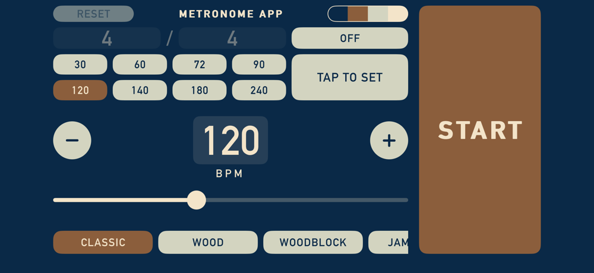

  

# Metronome

A free, one-screen metronome for iPhone and iPad. No ads, no accounts, no settings pages: everything you need is on the screen at once.

  
  &nbsp;
  

  

## Features

- **Sample-accurate timing.** The click is generated on the audio thread by counting samples, so it never drifts, and tempo changes apply instantly.
- **Tempo from 1 to 300 BPM**: a slider, hold-to-repeat +/− buttons, eight presets, tap tempo, or type it on a pop-up keypad.
- **Time signatures.** Any number of beats per bar, over a note value of 1, 2, 4, 8, 16, 32 or 64. With the time signature on, the first beat of each bar is accented and the click follows the note value (so 6/8 clicks eighth notes).
- **Thirteen click sounds**: Classic, Wood, Woodblock, Jam Block, Agogo, Shaker, Electric, Clave, Marimba, Snap, Clap, Cowbell and Hi-hat. Woodblock, Jam Block, Agogo and Shaker are recorded (in `Sounds/`); the rest are synthesised in code. Swipe the row for more. Your choice is remembered.
- **Record your own sounds.** Tap **+** at the end of the row, then clap, click or say "hey!" for the beat, and optionally the downbeat. Up to ten; hold or double-tap one to edit or delete it.
- **Share sounds.** The share button sends a sound as a small `.metrosound` file; opening it on another phone with the app offers to import it.
- **Eight colour palettes**, cycled from the button in the top right. Your choice is remembered.
- **A live metronome** replaces the title while it's playing, its arm swinging in time with what you hear.
- **Keeps playing in the background** and with the screen locked, mixes over music or video without stopping it, and stops cleanly for phone calls.
- **Portrait and landscape**, scaled up properly on iPad.

Buttons respond the instant they're touched, with no fades, and RESET lights up only when there's something to reset.

## Running it

You'll need Xcode with the iOS 27 SDK. The app targets iOS 27.

1. Open `Metronome.xcodeproj`.
2. Pick an iPhone or iPad (a Simulator or a connected device) from the device menu.
3. Press **⌘R**.

To run on your own device, choose your Apple ID under *Signing & Capabilities*, and turn on Developer Mode on the device. There are no dependencies to install.

## Project layout

| File | What it does |
|---|---|
| `Metronome.swift` | The audio engine: sample-counted clicks, accents, and the beat clock the visuals follow |
| `ClickSound.swift` | Synthesises the built-in click sounds |
| `CustomSounds.swift`, `SoundRecorder.swift`, `RecordSoundView.swift` | Recording, storing and naming your own sounds |
| `ContentView.swift` | The single screen and its layout for portrait, landscape and iPad |
| `Controls.swift` | Instant-response buttons, the slider, glyph-outline text, and the live metronome |
| `Keypad.swift` | The pop-up number pad and note-value picker |
| `Palette.swift` | The colour palettes |
| `Wobble.swift`, `Dancer.swift` | You'll see |

## Easter egg

Spoilers

Tap **METRONOME APP** and everything shivers. Tap faster and the shaking builds until the pieces fall off the screen, the title last of all. Clear the screen and something new lands in its place: a stick-figure dancer that dances in time with the click, changes move when tapped, and waits about impatiently while the metronome is stopped.

Dance every move and someone else joins in. RESET puts everything back.

